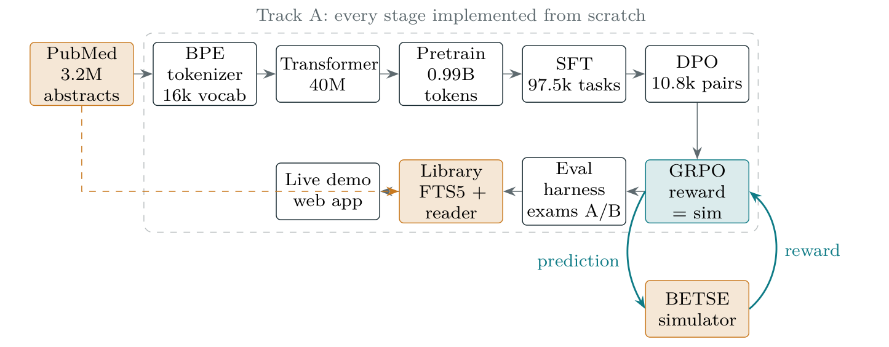

# CellBio-GPT

A small language model for cell and tissue bioelectricity, built from scratch, with a tissue simulator as the referee.

Nam H. Le, University of Vermont. [drnamlabs.com](https://drnamlabs.com) · live demo: [drnamlabs.com/cellbio](https://drnamlabs.com/cellbio/)



## The idea

Language models trained on papers learn how papers sound. In biology there is rarely anything that tells the model when a number it wrote is wrong. Bioelectricity is an exception, because the membrane physics can be simulated. [BETSE](https://github.com/betsee/betse) takes ion concentrations and channel permeabilities and returns the voltage of every cell in a tissue, in about 13 seconds per configuration.

This project uses that simulator in two ways. It scores the model's numeric predictions, so the model is trained against physics and not against someone's opinion of its answers. It also writes the exams, which makes it possible to ask whether the model learned anything beyond the training points.

The model keeps three kinds of knowledge in three places. Language lives in the weights. Facts live in a full-text library of 3.2 million PubMed abstracts that the model quotes with PMIDs. Physics lives in the simulator. The model is not asked to remember what a library or a simulator can look up.

## What is here

Every stage of a modern LLM pipeline, written for this project in plain PyTorch, on one RTX 5090:

| Stage | What it does | Folder |
|---|---|---|
| Corpus | 3.2M cell and tissue biology abstracts from PubMed, 0.99B training tokens | `data/` |
| Tokenizer | BPE, 16k vocabulary, written from scratch | `01_tokenizer/` |
| Model | 10-layer GPT, 40.5M parameters, RoPE, RMSNorm, SwiGLU, KV cache | `02_transformer/` |
| Pretraining | One epoch on the corpus, about an hour | `03_pretrain/` |
| SFT | 97.5k tasks mined from the corpus itself, loss on answers only | `04_sft/` |
| DPO, GRPO | Preference optimization, then RL against the Nernst equation | `05_dpo_rlvr/` |
| Evaluation | Perplexity, PubMedQA, simulator exams, contamination audit | `06_eval_release/` |
| Simulator RL | GRPO with BETSE as the verifier, plus two exams | `08_betse_rlvr/` |
| Library | SQLite FTS5 index over all abstracts, quote-only reader | `11_rag/` |
| Demo | Web app that sends each prediction to the real simulator | `10_demo/` |
| Domain adaptation | The same problem with a pretrained 135M model | `12_track_b/` |

`07_baldwin_rlvr/` holds an exploratory side study on curriculum design for the RL stage. It is not needed for the main result.

## Results

The model reads a problem such as "bath K+ is 12 mM, K+ permeability is 2x baseline, Na+ permeability is unchanged: what is the mean membrane potential?" and answers in millivolts. Reward is full within 2 mV and partial within 10 and 25 mV. The simulator knobs are three: extracellular K+, K+ permeability, Na+ permeability.

| | Exam A (held-out grid points) | Exam B (sealed, off-grid) |
|---|---|---|
| Constant predictor | 0.538 | 0.663 |
| Best open chat model, zero-shot | 0.529 | – |
| Best open chat model, five worked examples | 0.904 | – |
| Hosted model as agent (Claude Sonnet 5.5), zero-shot | 0.562 | 0.591 |
| Hosted model as agent (Claude Sonnet 5.5), five worked examples | **0.955** | 0.808 |
| 40M, trained on the grid | **0.945** | 0.539 |
| 40M, trained on random points | – | 0.777 |
| 40M, random points + five examples in the prompt | – | **0.835** |

The hosted-model rows come from a first, single forward test: an agent that read one question file and wrote one answer file, with no simulator access. It suggested a tie with the 40M model, so a larger test followed.

### Exam C: twenty sealed batches

Twenty batches of fresh simulations (300 simulations, 1,146 problems) were generated at points that appear in no training set and no earlier exam. They were fixed before any model saw them: the repository holds only their SHA-256 hashes (`08_betse_rlvr/exam_c/commitment.json`, committed before the exams) and the analysis plan (`08_betse_rlvr/exam_c/PLAN.md`). Each batch is one unit, so every comparison is paired over 20 batches. Mean reward over the batches:

| System | Zero-shot | Five worked examples |
|---|---|---|
| Claude Sonnet 5.5 (agent) | 0.602 | **0.852** |
| Claude Haiku 5.5 (agent, `claude-haiku-5-5`) | 0.569 | 0.842 |
| 40M, trained on random points | **0.772** | not trained for it |
| 40M, mixed warm start | 0.678 | 0.807 |
| 40M, trained on the grid | 0.500 | not trained for it |
| gpt-oss:20b (Ollama) | 0.511 | running |
| Qwen 3.5 (Ollama) | 0.465 | running |
| Qwen 3.6 (Ollama) | running | running |
| DeepSeek-R1 8B (Ollama) | 0.278 (see note) | running |
| Constant predictor | 0.708 | 0.708 |
| Nearest-neighbour lookup, no model (diagnostic) | n/a | 0.827 |

Mean reward over the 20 batches; "running" means the model has not finished the exam yet and the row will be filled in when it has. Zero-shot is the headline column: it shows what a model brings on its own. With worked examples in the prompt the large hosted models have the advantage, and they gain 0.25 to 0.27 from the examples (paired over 20 batches, 20 of 20 batches). DeepSeek-R1 always reasons before answering and was given 3,000 tokens; 679 of its 1,146 answers (59%) were cut off before a final line and score zero, so its row measures the token budget as much as the model. The constant predictor ignores the question and always answers the most common training answer for that kind of question; it is the floor, and a model below it has not learned the simulator. The open models ran through Ollama with default quantization, greedy decoding and one-line answers.

The comparison fixed in advance was the 40M model with five examples against the hosted agent with five examples. The agent is ahead by 0.045 (95% bootstrap interval 0.025 to 0.065 over batches, Wilcoxon p = 0.0014) and wins 17 of 20 batches. The near-tie in the first test did not hold. Both are above the constant predictor with five examples, and the agent also beats nearest-neighbour lookup (+0.025, p = 0.003) while the 40M model falls below it (-0.020, p = 0.015). Zero-shot the order flips: the agent is 0.106 below the constant predictor, and the 40M model trained on random points is 0.063 above it, which is evidence that the weights hold part of the simulator's response surface and the agent needs the examples to get there. Only the first comparison was the planned test; the rest are descriptive, and with twelve comparisons the secondary p-values should not be read at face value. Full table: `08_betse_rlvr/out/exam_c/stats.md`.

Limits: two hosted models (Sonnet 5.5 and Haiku 5.5), one run per batch, agent tool use checked only through the agents' own reports (none reported a rule breach). The 40M models were trained on this task and the hosted and open models were not, so the comparison is not like for like. The zero-shot column became the headline after the first-round results were seen (recorded in `08_betse_rlvr/exam_c/PLAN.md`); the planned test is the five-example one. The exam stays sealed until the remaining open-model runs finish: truths, questions and per-problem answers are withheld.

The earlier single test is in `08_betse_rlvr/out/agent_exam/`.

The second column is the one to read. The model trained on a regular grid scored 0.945 on held-out grid points and then fell below the constant predictor on points between the grid nodes. It had learned a lookup table: across 234 sealed problems it produced 17 distinct answers, and 16 of them were values it had memorized. Putting the same 150 simulations at random positions raised the off-grid score from 0.539 to 0.777 with no change to the model or the algorithm. Where the training data sits mattered more than which method was used.

Two more findings from the evaluation work:

- PubMedQA is a bad test of a 40M model. All four checkpoints score below the majority class, and the reason is a roughly 7-nat prior against the answer "no" that no training stage ever removes. The scores measured that prior, not reading ability.
- 59 of 1000 PubMedQA items share a PMID with the pretraining corpus. Every number is reported with and without them.

## What it cannot do

- It predicts one number, the mean membrane potential of a tissue, from three global knobs. It does not predict spatial patterns or anything that changes over time.
- Interpolation is weak. On off-grid problems it still emits mostly values it saw in training, and a small regression model on three inputs would likely do as well. The value of this part of the project is the training loop and the exam design, not the predictor.
- At 40M parameters it has no usable knowledge of biology in its weights. Questions about facts go to the library, which quotes sources and declines when nothing in a retrieved abstract supports an answer.
- It does not read evidence. It cannot do PubMedQA, and the diagnosis in `06_eval_release/` shows why.

## Track B: starting from a pretrained model

`12_track_b/` repeats the pipeline with SmolLM2-135M in place of random weights, using the same corpus and the same exams. No stage trains on the from-scratch model's outputs. The later instruction mixtures do include SmolTalk, which was itself written by larger models. Continued pretraining reaches the from-scratch model's held-out loss after about 131M tokens and ends at 0.640 bits per byte against 0.698. The chat ability the base model starts with then erodes. Short-answer tasks taught short answers, and a mixed instruction set taught the model that biology questions get the paper register and everything else gets a chat register. The write-up explains the diagnosis and what data would fix it.

## Paper

`09_report/tech_report/report.pdf` is the full account, 16 pages, including the problems met on the way (the NCBI 10k record cap, a simulator that ignores custom concentrations without saying so, a left-padding bug that made a working reader score 0.39) and how each was fixed. It is a technical report and has not been peer reviewed.

## Running it

Two environments are needed because BETSE 1.5.0 does not run on Python 3.13.

```
pip install -r requirements.txt                 # training, evaluation, demo
python -m venv .venv-betse                      # Python 3.11 or 3.12
# activate it, then:
pip install -r requirements-betse.txt
```

```
python 00_setup/check_env.py                    # GPU, threads
python -I data/build/fetch_corpus.py data/corpus   # the full pull takes hours
python 01_tokenizer/train_tokenizer.py --smoke
python 10_demo/serve_demo.py                    # http://localhost:8765
```

Each stage folder has scripts with a usage note at the top, a `out/` folder with its figures, logs and metrics, and the figure that explains the stage. Scripts cap GPU memory and CPU threads explicitly, since the machine they were written on is shared. Seed 42 throughout, recorded in each saved artifact.

Checkpoints and the simulator exams are published on Hugging Face and are not in git:

- Model, six checkpoints and a model card: [drnamlabs/cellbio-gpt-40m](https://huggingface.co/drnamlabs/cellbio-gpt-40m)
- Simulator exams and problems: [drnamlabs/cellbio-betse-exams](https://huggingface.co/datasets/drnamlabs/cellbio-betse-exams)

## Related work and credit

BETSE is by Alexis Pietak and the Levin lab. The design follows nanoGPT for the model, DeepSeekMath for GRPO and the Tülu 3 work for verifiable rewards. The full list of references is in the report.

## Licence

MIT. See `LICENSE`. The PubMed abstracts keep their original terms and are not redistributed here.

`LOG.md` is the dated development log. `KNOWLEDGE.md` holds the working notes.
